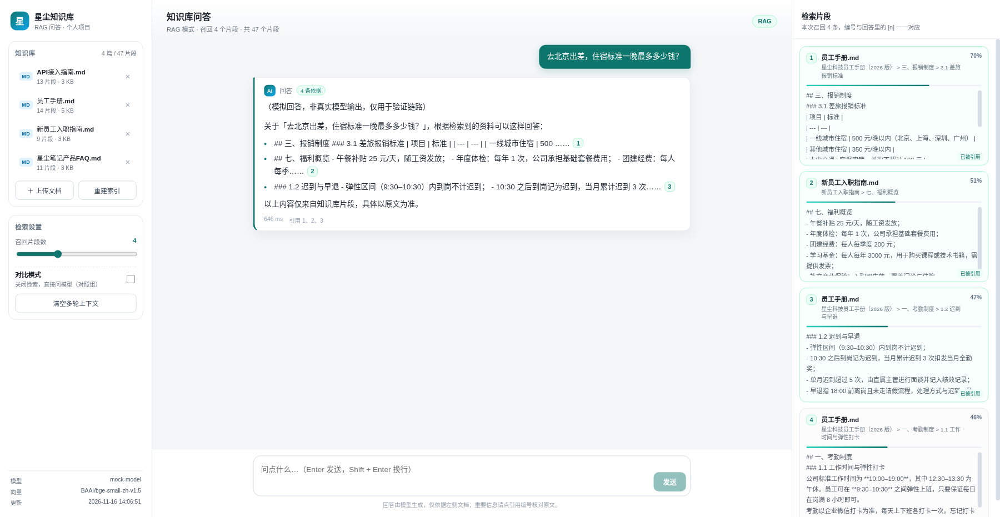

# 星尘知识库 · 个人知识库问答 Agent（RAG）

把公司制度、产品文档丢进去，然后像问同事一样提问：**回答只依据你上传的文档，每条结论都能点回原文。**

这不是一个"调用大模型接口"的 demo，而是一条完整的 RAG（检索增强生成）链路：文档切分 → 向量化 → 向量检索 → Prompt 拼装 → 流式生成 → 引用回溯，前后端都能跑。

- **配套教程**：[docs/新手教程.md](docs/新手教程.md) —— 从装 Python 开始，一步一步带你跑通
- **评测记录**：[docs/评测与迭代.md](docs/评测与迭代.md) —— 20 条测试问答的方法与真实结果
- **排错手册**：[docs/常见报错与排错.md](docs/常见报错与排错.md)
- **在线 Demo**：待部署

## 界面预览



> 左侧管理知识库，中间对话，右侧是本次召回的所有片段。回答里的 `[1]` `[2]` 可以点击，右侧对应卡片会高亮。
> 截图中的回答由「本地 Mock 模型」生成（用于验证前后端链路，不代表真实模型效果）。

## 它解决了什么问题

直接问大模型有三个绕不过去的问题：

| 问题 | 表现 | 本项目的做法 |
| --- | --- | --- |
| 不知道你的私有资料 | 问"我们公司年假几天"，模型只会瞎猜 | 先从你的文档里检索，再把原文塞进 Prompt |
| 会编造 | 编出看似合理的数字、日期、流程 | Prompt 强制"只依据资料"，并要求逐条标注引用编号 |
| 无法追溯 | 说错了你也不知道错在哪 | 回答里的 `[n]` 对应右侧原文片段，一键核对 |

## 功能清单

**知识库**
- 支持 `.md` / `.txt` / `.pdf`，按 Markdown 标题切段，每段都保留「文件 + 章节」元信息
- 上传即索引、删除即清理、支持一键重建；增量索引只处理变动的文件
- 单文件索引失败不影响其它文件

**检索**
- Chroma 向量库（余弦相似度），中文向量模型 `BAAI/bge-small-zh-v1.5` 或任意云端 Embedding
- 返回相似度分数，前端用进度条展示，方便判断"这条到底靠不靠谱"

**生成**
- 任何 OpenAI 兼容模型：硅基流动 / DeepSeek / 通义千问 / 智谱 / OpenAI
- SSE 流式输出（先推检索结果，再逐字推答案）
- Prompt 里带编号的参考资料 + 严格的引用规则

**多轮对话**
- 「那它要提前几天申请？」这类指代，先用 LLM 改写成完整问题再检索
- 改写结果异常时自动回退原问题（实测踩过的坑）
- 历史只保留最近 N 轮，避免 token 越烧越多

**对照实验**
- 左侧「对比模式」开关：关掉检索直接问模型，用来验证 RAG 到底有没有用
- `scripts/eval.py` 批量跑 20 条问题，输出 CSV + Markdown 报告

## 技术栈

| 层 | 选型 |
| --- | --- |
| 后端 | Python 3.11+ / FastAPI / Uvicorn |
| 编排 | LangChain（`ChatPromptTemplate \| ChatModel \| StrOutputParser`） |
| 向量库 | Chroma（本地持久化，零部署） |
| Embedding | 云端 OpenAI 兼容接口 或 本地 `sentence-transformers` |
| 前端 | React 18 / Vite / 原生 CSS（无 UI 框架，方便改） |
| 测试 | pytest（10 个用例，含真实检索用例） |

## 架构

```
                    ┌──────────────── 前端 React ────────────────┐
                    │ 左：知识库管理   中：对话   右：检索片段    │
                    └───────────────┬───────────────────────────┘
                                    │ POST /api/chat（SSE 流式）
┌───────────────────────────────────▼──────────────────────────────────┐
│ FastAPI                                                              │
│  1. 查询改写（有历史时）  "那它呢" → "星尘笔记 Pro 版年费多少"        │
│  2. 向量检索           Embedding(question) → Chroma top_k            │
│  3. 拼 Prompt          [1]《员工手册》· 2.1 年假 … + 问题            │
│  4. 生成               ChatModel 流式输出                            │
│  5. 回填引用           正则抽出 [n]，过滤越界编号                    │
└───────────┬──────────────────────────────────────┬───────────────────┘
            │                                      │
     ┌──────▼──────┐                       ┌───────▼────────┐
     │  Chroma     │                       │ LLM（OpenAI 兼容）│
     │ 47 chunks   │                       │ DeepSeek/通义/…  │
     └─────────────┘                       └────────────────┘
```

## 快速开始

```bash
# 1. 后端
cd backend
python -m venv .venv
source .venv/bin/activate          # Windows: .venv\Scripts\activate
pip install -r requirements.txt

cp .env.example .env               # 然后编辑 .env，填入 LLM_API_KEY
python -m scripts.ingest --rebuild # 建库
uvicorn app.main:app --reload --port 8000

# 2. 前端（另开一个终端）
cd frontend
npm install
npm run dev                        # 打开 http://localhost:5173
```

只想先看看界面、还没申请 Key？用本地 Mock 模型跑通链路：

```bash
cd backend
python -m scripts.mock_llm                                   # 终端 1
LLM_BASE_URL=http://127.0.0.1:9999/v1 LLM_API_KEY=mock \
  LLM_MODEL=mock-model uvicorn app.main:app --port 8000      # 终端 2
```

> Mock 只把检索到的片段回声出来，**不是真实回答**，仅用于验证接口和界面。

## 目录结构

```
rag-knowledge-agent/
├── backend/
│   ├── app/
│   │   ├── config.py          # 所有配置集中在这里（只读 env）
│   │   ├── main.py            # FastAPI 路由 + SSE
│   │   ├── session.py         # 多轮历史（内存版，生产换 Redis）
│   │   ├── schemas.py         # 请求/响应模型
│   │   └── rag/
│   │       ├── loader.py      # 加载 + 按标题切分
│   │       ├── embedder.py    # 向量模型工厂（api / local）
│   │       ├── vectorstore.py # Chroma 封装、增量索引、manifest
│   │       ├── prompts.py     # 所有 Prompt 模板
│   │       └── chain.py       # ★ 核心：改写→检索→拼装→生成→引用
│   ├── data/
│   │   ├── docs/              # 示例知识库（4 份虚构公司文档）
│   │   └── questions.json     # 20 条测试问答
│   ├── scripts/
│   │   ├── ingest.py          # 命令行建库
│   │   ├── eval.py            # 20 条评测
│   │   └── mock_llm.py        # 本地假模型（联调用）
│   ├── tests/                 # pytest
│   ├── requirements.txt
│   └── .env.example
├── frontend/
│   └── src/
│       ├── api.js             # 所有请求 + SSE 解析
│       ├── App.jsx            # 三栏布局与状态
│       └── components/        # Sidebar / MessageItem / SourcePanel / Composer
└── docs/                      # 教程、评测、排错、截图
```

## 效果：20 条测试问答

测试集设计：17 条有标准答案（可从文档查到），3 条文档里根本没有答案（检验会不会编造）。

| 指标 | 结果 |
| --- | --- |
| 检索命中率（期望文档出现在 top4） | **17/17 = 100%** |
| Top1 命中率（期望文档排第一） | **17/17 = 100%** |
| 平均检索耗时 | 约 30–200 ms（本地向量模型，暖机后） |
| 回答质量 | 需自备 API Key 后运行 `python -m scripts.eval` 生成，本仓库不伪造数据 |

> 检索层的结果是本地实测的（见 `docs/评测报告-检索.md`）。生成层的效果依赖你使用的模型，跑完会覆盖 `backend/output/eval_report.md`。
> 3 条"无答案"问题（股票代码 / CEO 姓名 / 年会时间）用来验证模型会不会硬编——这是 RAG 项目最该测的一项。

## 已知限制

- 会话历史存内存，重启即清空；多实例部署需要 Redis
- 纯向量检索，对"编号、代码、专有名词精确匹配"不如关键词检索，可加 BM25 混合
- 没有 rerank，top_k 取 4 时偶尔会带进无关片段（截图里第 3、4 条就是）
- 没有鉴权，只适合本地或内网 Demo
- PDF 只做文本抽取，扫描件需要先 OCR

## Roadmap

1. BM25 + 向量混合检索，再上 bge-reranker
2. 文档更新自动增量（监听目录变化）
3. 引用精确到段落高亮
4. 评测集扩充到 50 条，加入"答非所问""多跳问题"
5. Docker Compose 一键部署

## License

MIT
